# Art Direction Research: Evolving co-MMO Toward Luminous Dark Fantasy ("Twilight Mythic")

> **Core Thesis:** Making *co-MMO* darker **without losing its fantasy soul** requires shifting from **High-Key Pastel Uniformity** (`Style Bible v3`) to **Chiaroscuro Mythic Contrast**—deep mineral environment values ($L \in [45, 95]$) that turn darkness into a velvet stage for **saturated jewel-tone magic (*Wishstuff*)**, **warm sanctuary hearths**, **weathered gothic-monolithic silhouettes**, and **uncanny fairytale creatures of the Hush**.

---

## 1. Why Dark Fantasy Fits *Wishmere* (Narrative-Visual Alignment)

In [`docs/world.md`](./world.md), the narrative foundation of *Wishmere* already possesses a haunting, mythic dark-fantasy soul:

- **The Silence of the Listener & The Hush:** An ancient God granted every wish without restraint until catastrophic wishes broke the world, plunging creation into *the Hush*—a creeping metaphysical amnesia in which roads forget where they lead, golems forget whom they served, and kingdoms crumble into overgrown silence.
- **Tragic Relics of Broken Wishes:**
  - *Mossgate's War Wish:* Bark-and-iron golems that won a war and now wander forgotten ruins around Sir Alder, the last knight.
  - *The Sun King's Wish:* Undying funerary guards marching every night out of desert crypts to defend a dead dynasty.
  - *The Chained Demon:* An apocalyptic war-wish bound beneath the High Cathedral by aging celestial runes that *"hold, for now."*
- **Wishstuff & The Waking Shrine:** Half-granted wishes settled across the earth like shimmering dew (*wishstuff*), animating uncanny creatures and fueling Wishweavers, while a young, warm God has newly awakened at the Sanctum Shrine.

### The Current Tension: Mythic Melancholy vs. Daytime Storybook Pastels
Currently, [`FLAT_ISOMETRIC`](../packages/server/src/assets/style-profile.ts) (`Style Bible v3`) mandates *"soft, muted warm pastels (sand, terracotta, dusty rose, sage green, teal, cream, brass)"* paired with bright ambient daylight (`SKY_FILL = 0.55`). As a result, **the lore speaks in the register of *Elden Ring*, *Hollow Knight*, and *Death's Door*, while the screen speaks in the register of a sunny pastoral life-sim.**

### Avoiding the "Muddy Grimdark" Trap
A naive push toward "dark fantasy" often fails by desaturating everything into brown/grey mud, adding noisy grime textures, and crushing shadows to `#000000`—which would:
1. Erase the wonder of *Wishstuff* and the warmth of the young God;
2. Break `co-MMO`'s clean planar low-poly visual identity; and
3. Contaminate `#FF00FF` chroma-keying (`assets/postprocess/key-cut.ts`) and stair/corridor tactical readability (`docs/buildings-and-walls.md`).

Instead, the target aesthetic is **Luminous Dark Fantasy ("Twilight Mythic")**:
- **Darkness is the canvas (60% area):** Deep obsidian slate, wet moss, smoked oak, basalt, and twilight mist.
- **Heritage materiality is the structure (30% area):** Tarnished bronze, weathered bone, oxblood cloth, cold-forged iron, and carved limestone.
- **High-chroma Fantasy is the focal spark (10% area):** Bioluminescent cyan-gold *Wishstuff*, amber sanctuary braziers, spectral runes, stained-glass moonbeams, and uncanny fungal glow. **Magic feels *more* fantastical in a dark world because light can only truly glow against shadow.**

---

## 2. Visual & Technical Audit of the Current State of `co-MMO`

### 2.1 Live Engine Screenshots Across Biomes, Hours & Cutaways

| Current Daylight Baseline (`sanctum-noon`) | Current Night Lighting (`sanctum-night`) |
| :---: | :---: |
| 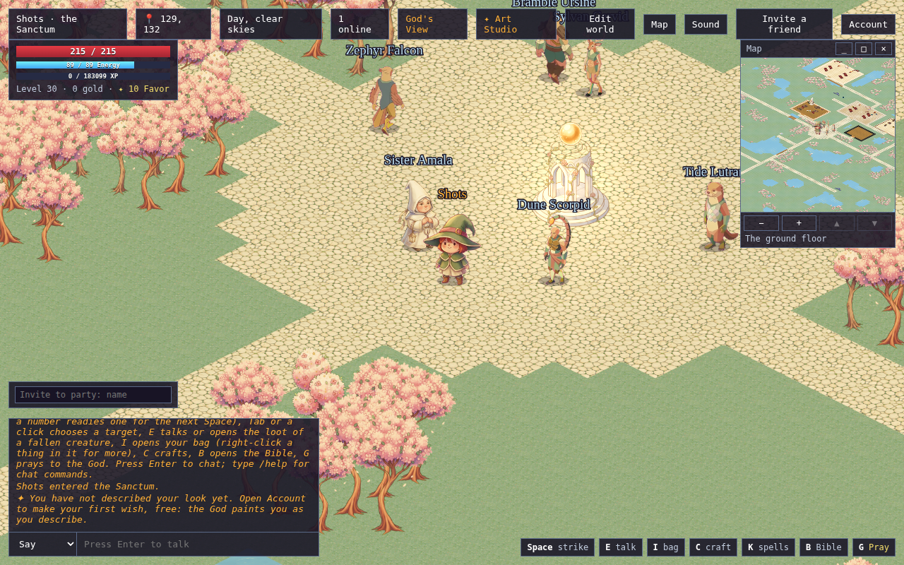 | 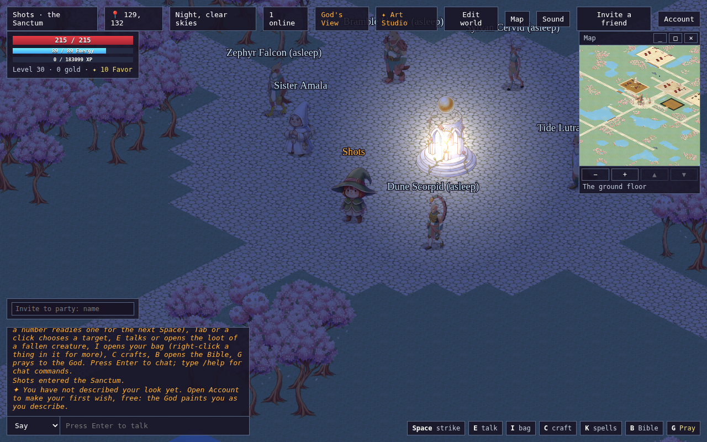 |
| High-luminance cream flagstones ($L = 216.2$) and pastel blossom trees flatten contrast; the shrine orb cannot visually radiate against near-white stone. | `NIGHT_TINT = 0x5866a8` bathes the world in soft periwinkle-lavender rather than nocturnal shadow; windows and runes dim alongside stone. |

| Cutaway Interior (`sanctum-temple-inside`) | Multi-Storey Geometry (`terrace-rim-cliff-skirt-f1`) |
| :---: | :---: |
| 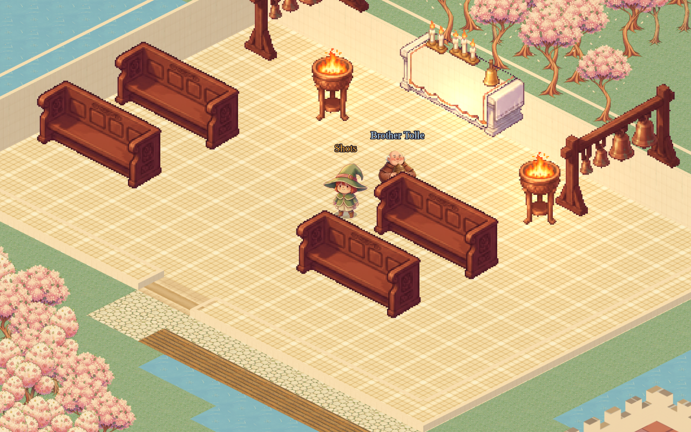 | 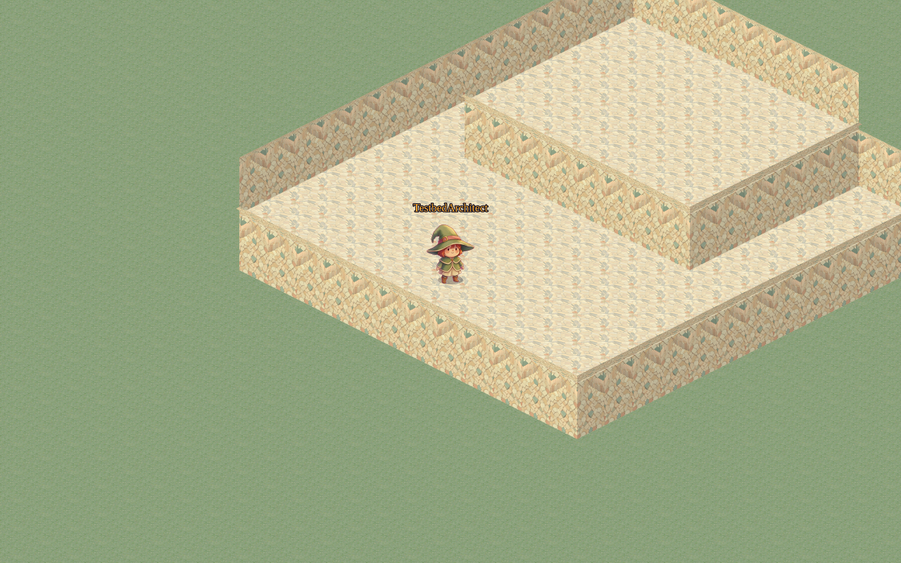 |
| Isometric cutaway walls (`rockWalls`) read cleanly in 3D, but high-key cream chequer floors leave indoor altar lights with little shadow headroom to carve pools of mystery. | Demonstrates `co-MMO`'s crisp 2:1 isometric projection and `168px` figure scale; pale repeating masonry lacks vertical weathering or contact grounding. |

| Whispering Woods Noon (`woods-noon`) | Whispering Woods Fog (`woods-fog`) | Mirage Desert Noon (`desert-noon`) |
| :---: | :---: | :---: |
| 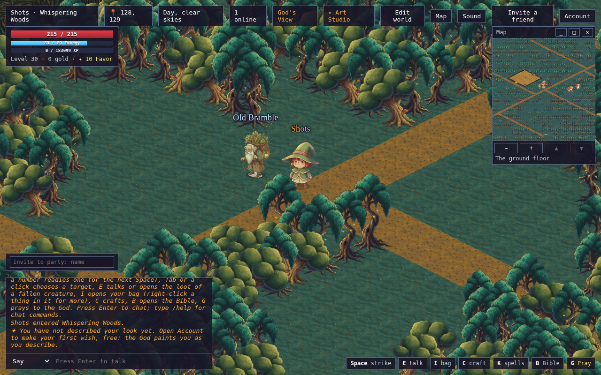 | 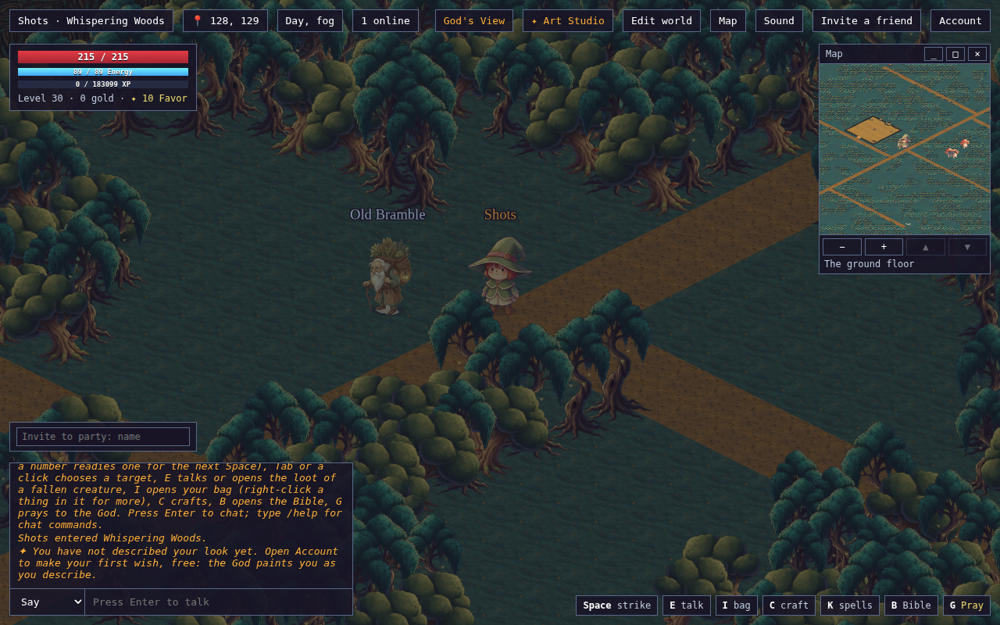 | 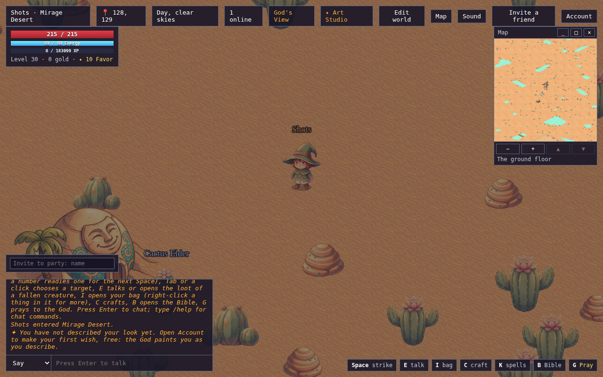 |
| **Strongest existing baseline:** Darker moss ground ($L = 81.0$) immediately gives characters and foliage richer figure-ground pop. | `WEATHER_TINT.fog = 0xd4d9de` lifts midtones uniformly rather than adding depth-layered twilight mist. | Warm peach sand ($L = 191.8$) reads cheerful rather than evoking cursed Sun-Court tombs and buried cathedrals. |

### 2.2 Quantitative Colorimetric & Shader Diagnosis

Measuring solid-pixel luminance ($L = 0.299R + 0.587G + 0.114B$, $0\text{–}255$) across shipped assets in `packages/client/public/art/` reveals **why** the game currently resists a dark-fantasy mood even when lamps and night cycles are active:

| Shipped Asset | Role | Mean RGB | Mean Luminance ($L$) | 90th Percentile $L$ | Mean Saturation | Visual Consequence |
| :--- | :--- | :---: | :---: | :---: | :---: | :--- |
| `shore-sand.png` | Ground Tile | `(250, 241, 215)` | **`240.7`** | `244.1` | `14.2%` | Near-white ground clips dynamic point lights immediately. |
| `sanctum-flagstones.png` | Hub Path Tile | `(224, 218, 187)` | **`216.2`** | `237.1` | `17.6%` | Brighter than players (`145.7`), inverting figure-ground focus. |
| `desert-dunes.png` | Ground Tile | `(241, 180, 122)` | **`191.8`** | `201.0` | `49.6%` | High-key apricot warmth suppresses ancient tomb tension. |
| `sanctum-meadow.png` | Ground Tile | `(154, 183, 148)` | **`170.4`** | `176.3` | `19.9%` | Pastel sage lawn reads pastoral rather than sacred/ancient. |
| `bramble-ursine.png` | Player/NPC Sprite | `(170, 139, 114)` | **`145.7`** | `190.3` | `35.7%` | Darker than 3 of 4 launch grounds (silhouette inversion). |
| `desert-mummy-guard.png` | Creature Sprite | `(137,  99,  89)` | **`109.6`** | `184.4` | `43.8%` | Reads as a dark cutout on bright sand instead of emerging from shadow. |
| `woods-moss.png` | Ground Tile | `( 59,  91,  87)` | **`81.0`** | `89.1` | `37.5%` | **Ideal dark-fantasy ground value**—characters & lanterns pop! |
| `bramble-cottage-wall.png` | Cutaway Wall | `( 51,  50,  46)` | **`49.7`** | `69.1` | `22.3%` | Strong dark enclosure value that frames warm interior furniture. |

#### Four Engine-Level Root Causes Identified in Code
1. **Inverted Figure-Ground Value Hierarchy:** In classic dark-fantasy isometric games, ground and walls occupy **low-to-mid values ($L \approx 40\text{–}95$)**, characters occupy **mid-to-high values ($L \approx 110\text{–}175$)**, and magic/fire occupies **peak values ($L \approx 210\text{–}255$)**. In `co-MMO` today, ground tiles (`170–241`) outshine characters (`110–146`).
2. **Multiplicative Shader Clipping (`lit-pipeline.ts`):** Line 77 of [`packages/client/src/lit-pipeline.ts`](../packages/client/src/lit-pipeline.ts) computes `gl_FragColor = color * vec4(light, 1.0)`. Because `color` on pale ground is already `0.85–0.95`, adding `LAMP_LIGHT` (`#ffd27a`) or `HOLY_LIGHT` (`#ffe9b0`) saturates to `1.0` instead of carving warm amber pools out of dark stone.
3. **High Ambient Fill & Soft Lavender Night (`lighting.ts` & `sky.ts`):** `SKY_FILL = 0.55` floods facets facing away from the sun, muting normal-map faceted drama (`uNormSampler`), while `NIGHT_TINT = 0x5866a8` produces a cosy periwinkle night rather than deep obsidian-indigo (`~0x242e47`).
4. **Unpopulated Emissive Pass (`lit-pipeline.ts:75`):** As the existing comment in `lit-pipeline.ts` already notes (*"Room for a glow map next: painted flames and windows that shine on their own would be added here, after the light, so night cannot dim them"*), magical runes, stained glass, creature eyes, and *wishstuff* currently get multiplied down by `NIGHT_TINT` at night instead of glowing autonomously.

---

## 3. External Reference Benchmarks: Darker Without Losing Fantasy

To prove that **dark fantasy** and **stylized, whimsical, high-magic fantasy** reinforce each other rather than conflict, we benchmark five reference titles that solve specific pieces of `co-MMO`'s visual puzzle:

### 3.1 *Death's Door* (Acid Nerve) — Faceted Low-Poly Geometry + Somber Mythic Atmosphere

| Somber Twilight Masonry & Warm Braziers | High-Chroma Arcane Energy on Clean Geometry |
| :---: | :---: |
| 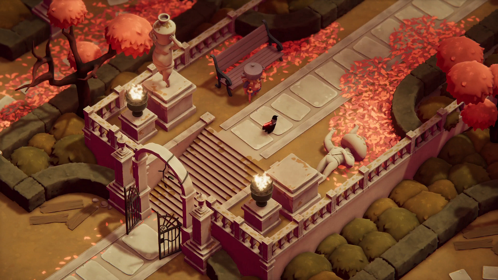 | 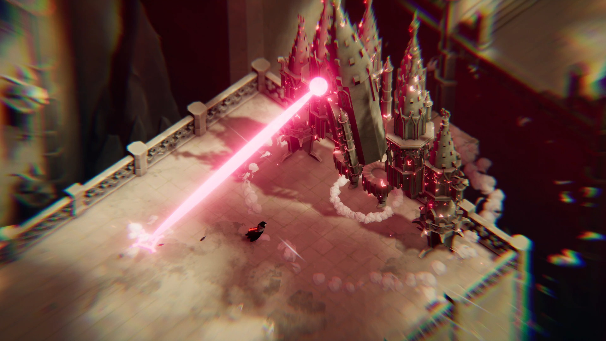 |

- **Why It Matters for `co-MMO`:** *Death's Door* uses **lineless, crisp-edged, low-poly architectural geometry** closely aligned with `FLAT_ISOMETRIC`. It achieves a haunting, melancholic fairytale tone—not through gritty realism—but through **weathered mauve-slate stone, wrought-iron gates, crooked bare branches, and solemn statues**, punctuated by **vivid salmon-crimson foliage, warm brazier flames, and electric magenta/cerise arcane beams**.
- **Takeaway:** Keep `co-MMO`'s clean faceted shapes and playful creature silhouettes (a tiny crow knight, an urn-headed spirit), while aging the architecture and deepening shadow values.

### 3.2 *Tunic* (Isometric Team) — Planar Chiaroscuro & Subterranean Mystery

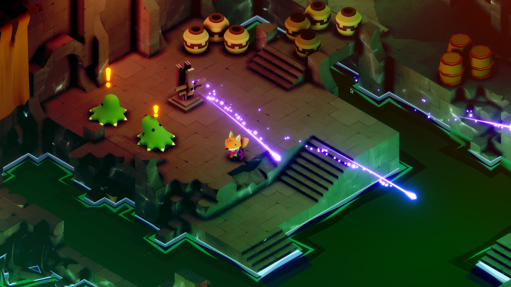

- **Why It Matters for `co-MMO`:** *Tunic* proves that **pure, untextured geometric planes** can feel ancient, dangerous, and deeply mysterious when lit with **steep directional falloff**. Notice how the subterranean water sits at near-abyssal dark teal (`RGB ~ 8, 32, 24`), stone blocks sit in mid-dark umber/olive (`L ~ 65`), and **neon-violet/cyan obelisk energy** slices across the dark stairs with unmistakable fantasy wonder.

### 3.3 *Hades II* (Supergiant Games) — The "Nocturnal Jewel-Tone" Anti-Grimdark Rule

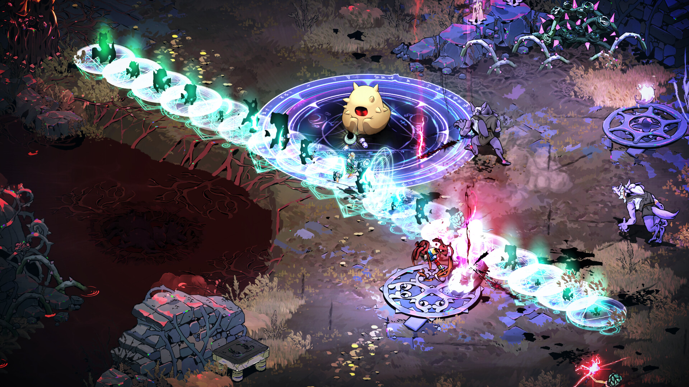

- **Why It Matters for `co-MMO`:** *Hades II* avoids muddy brown grimdark by pairing **charcoal, midnight-indigo, and bruised-plum grounds** with **hyper-luminous witchlight cyan, spectral jade, royal violet, and crimson**. Because 75% of the terrain is low-value/low-chroma, spell circles (`marks` and `bursts` in `packages/shared/src/skill-art.ts`) become breathtaking spectacles while remaining 100% readable in chaotic combat.

### 3.4 *No Rest for the Wicked* & *V Rising* — Canopy Vignetting, Gothic Cutaways & Sanctuary Warmth

| *No Rest for the Wicked* — Spotlit Traversal | *V Rising* — Gothic Brazier Halls | *V Rising* — Moonlight vs. Lantern Pools |
| :---: | :---: | :---: |
| 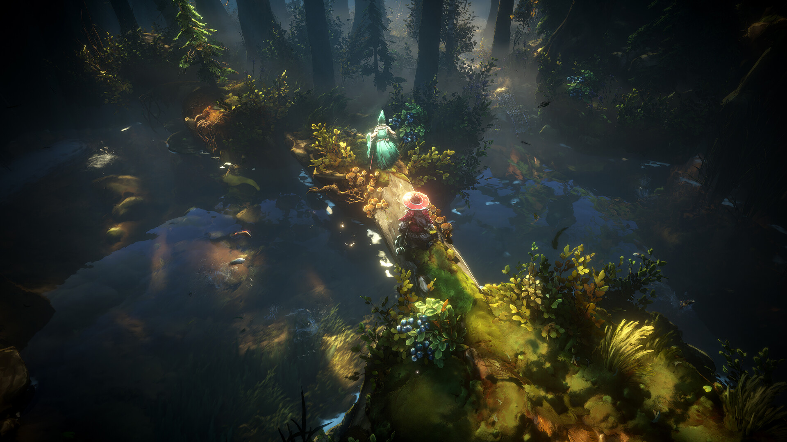 | 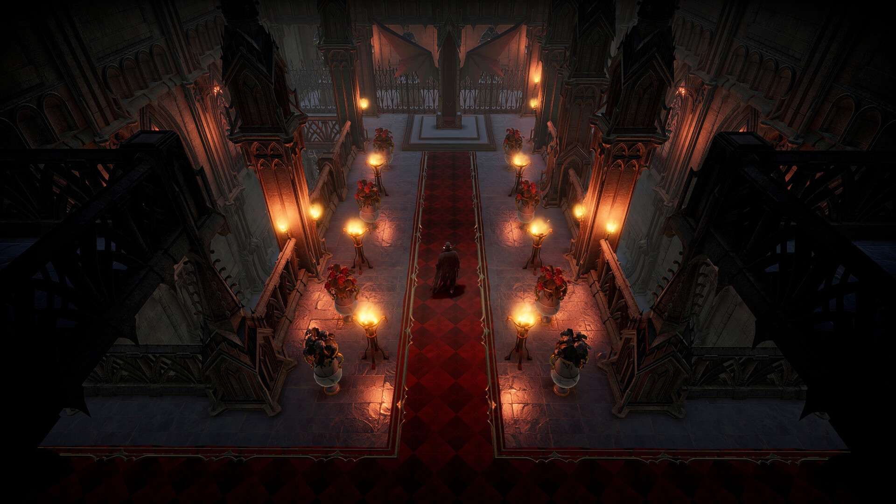 | 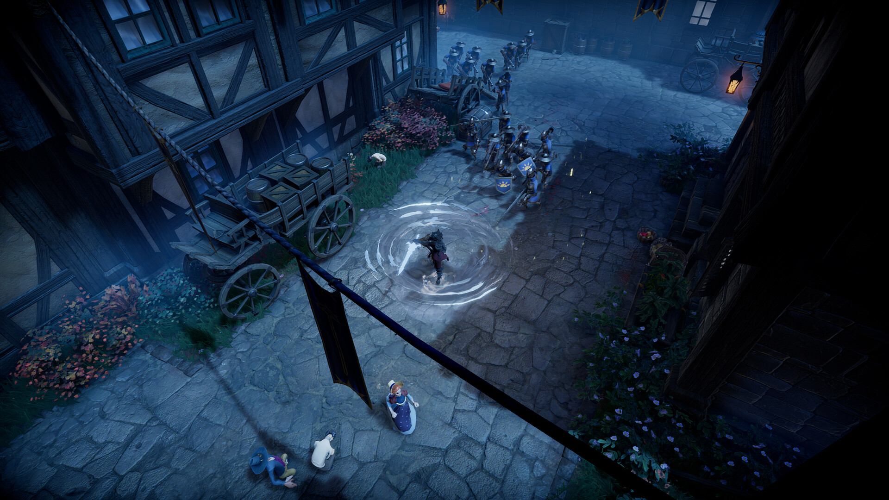 |

- **Why They Matter for `co-MMO`:**
  - **The "Pool of Safety" Principle:** In *V Rising* and *No Rest for the Wicked*, cool blue-slate moonlight (`~0x2b3a55`) rules the wilds, making every **amber lantern, inn window, and temple brazier (`#ffaa44`)** feel emotionally magnetic—reinforcing *Wishmere*'s lore where the Sanctum Shrine is a warm island of memory against *the Hush*.
  - **Vertical Gothic Rhythms:** Pointed arches,ribbed pillars, iron sconces, and oxblood runners immediately elevate isometric cutaway rooms (`rockWalls`) from "simple cottages" to "ancient orders of Wishmere."

---

## 4. Five Concrete Art Direction Proposals & New Generated Concept Assets

Using the local image generation workflow, we produced six bespoke concept assets adhering to `co-MMO`'s **2:1 orthographic isometric camera**, **crisp flat-faceted low-poly geometry**, **cutaway wall architecture**, and **seamless square-on texture pipeline** to illustrate how *Wishmere* transforms into **Twilight Mythic** dark fantasy.

---

### Proposal 1: Reimagining Hubs as "Pools of Warmth in the Encroaching Hush"

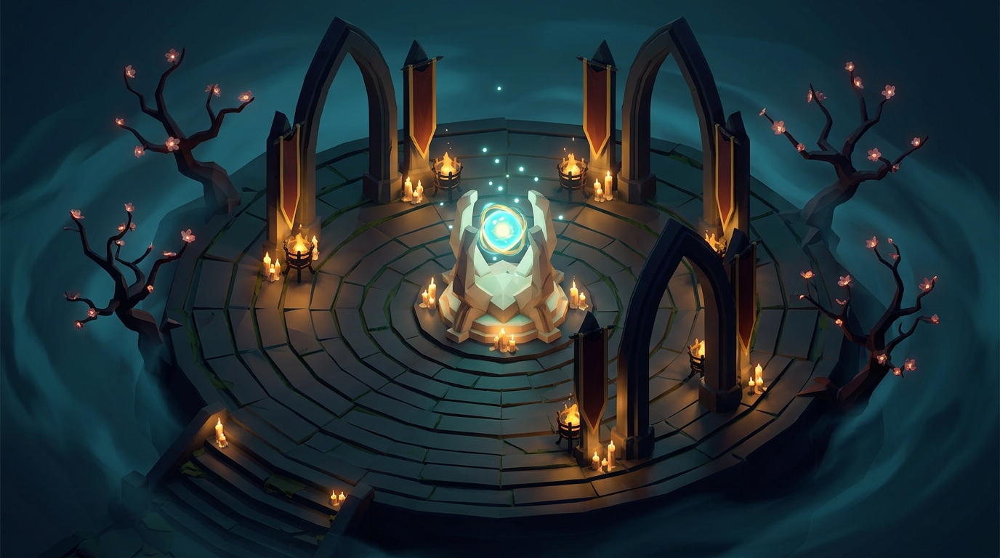
*Generated Concept 1 — **The Sanctum Shrine Reimagined**: Concentric rings of weathered obsidian-slate flagstones ($L \approx 55\text{–}75$) replace near-white cream stone ($L = 216$). Pointed monolithic arches, oxblood banners, candle clusters, and wrought-iron braziers create warm amber pools around the pale-bone shrine, allowing the cyan-gold **Wishstuff Orb** and ember-petal blossom trees to genuinely radiate.*

#### How It Preserves Fantasy While Going Darker
- **Emotional Contrast, Not Despair:** The Sanctum remains warm, sacred, and welcoming—but that warmth now comes from **votive firelight and living Wishstuff** pushing back surrounding twilight mist, rather than flat midday sun.
- **60 / 30 / 10 Value & Chroma Rule:**
  - **60% Deep Mineral Ground & Shadow:** Obsidian slate (`#262a36`), damp moss seams (`#284540`), deep indigo mist (`#162630`).
  - **30% Weathered Sacred Structure:** Pale bone shrine stone (`#d8ceb8`), tarnished brass (`#9c7a44`), liturgical oxblood (`#6e2430`).
  - **10% Luminous Wishstuff & Flame:** Astral cyan-gold orb (`#6ef7e8` / `#ffd166`), flickering candle amber (`#ff9e3b`), glowing blossom petals (`#f08a7e`).

---

### Proposal 2: "Enchanted Melancholy" Across Biomes (Folklore Wonder Over Gore)

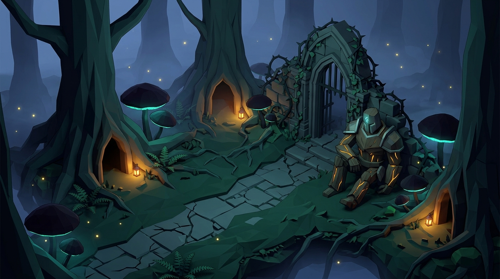
*Generated Concept 2 — **Whispering Woods & Mossgate Ruin**: Towering charcoal-teal trunks with warm lantern-lit root hollows, sunken slate flagstones, a thorn-wrapped gothic gatehouse, and a slumbering **Bark-and-Iron Mossgate Golem** veined with glowing amber sap and a spectral cyan rune, surrounded by bioluminescent velvet mushrooms and indigo fog.*

#### Biome-by-Biome Dark-Mythic Palette & Motif Upgrade (`packages/shared/src/biomes.ts`)

| Biome | Current Look (Pastel v3) | Proposed "Twilight Mythic" Direction | Proposed `keyColors` | Proposed `lightTint` |
| :--- | :--- | :--- | :--- | :--- |
| **The Sanctum** | Cream stone, pink blossoms, sunny clover | Obsidian-slate rings, gothic arches, votive candles, ember-petal trees, cyan-gold Wish Orb | `0x2b303d`, `0xd6cbb5`, `0x7a2834`, `0x64f0df` | `0xefe4d2` |
| **Whispering Woods** | Bright moss, cosy hollow logs | Deep pine-slate canopy, lantern-lit root doors, thorn-choked Mossgate ruins, teal spore-caps | `0x1e3b36`, `0x3b2c26`, `0x4a6b53`, `0xf5b841` | `0xcadbd0` |
| **Sunlit -> *Gloaming* Shore** | Tourist-bright white sand & turquoise | Wet volcanic black-and-pearl sand, bioluminescent tidepools, barnacled shipwrecks, abyssal coral | `0x1f4e5f`, `0x8c8578`, `0x283347`, `0x5ef2e4` | `0xdce8f2` |
| **Mirage Desert** | Peach dunes & bright sandstone | Burnt umber-ochre twilight dunes, obsidian obelisks, half-buried Sun-King colossi, teal soul-fire | `0x8f5b38`, `0x362a33`, `0xc49245`, `0x4de8d2` | `0xf0d5b8` |
| **Frostpeak** | Crisp pastel baby-blue snow | Storm-slate crags, rime-silver monoliths, aurora-tinted ice fissures, warm fur-lined eyrie hearths | `0x7d95b0`, `0x2b3548`, `0xd8e2f0`, `0x6ef0d6` | `0xd2def2` |
| **Mushroom Hollow** | Pastel lavender & pink caps | Deep velvet-indigo mycelium mats, towering dark caps with glowing cyan/magenta gill-veins | `0x2d2240`, `0x6e2b5c`, `0x1c3842`, `0x5cf2e8` | `0xc6bde0` |

---

### Proposal 3: Gothic Isometric Cutaways & High-Contrast Traversal (`rockWalls` & `KitLook`)

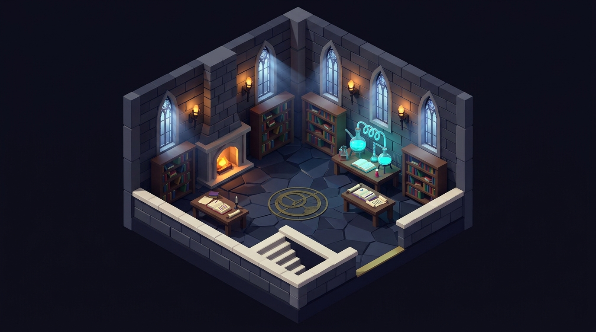
*Generated Concept 3 — **Isometric Cutaway Interior (`The Arcanum Reliquary`)**: Follows `co-MMO`'s asymmetric cutaway rules (`docs/buildings-and-walls.md`)—full-height North/West back walls in dressed dark basalt with moonlit lancet windows and warm iron sconces; knee-high South/East cutaway walls (`WALL_RISE = 0.25`) topped with high-contrast pale limestone coping caps and a `L >= 110` descending stairwell with a brass threshold lip.*

#### Architectural Rules That Preserve Tactical Clarity
1. **Dark Walls + Pale Coping Caps:** When interior floors and walls shift to dark basalt/slate (`L ~ 45–65`), topping cutaway walls (`registerWallCopingCap` in `textures.ts`) and stair rims (`stair-art.ts`) with **carved pale bone/limestone (`L >= 135`) and tarnished brass thresholds** guarantees players immediately read room boundaries, doorways, and vertical traversal (`biome-stairs.test.ts` $L \ge 110$ invariant preserved!).
2. **Dual-Temperature Interior Lighting:** Combine cool silver-blue window shafts (`#7aa2e8`) from Gothic lancets with warm amber hearth/sconce pools (`#ff9e42`) and a third **Arcane Accent Light** (`#3df5e6` on scrying basins, alembics, and shrines) so every room tells a visual story.
3. **Weathered `KitLook` Evolution (`building-kit/looks.ts`):** Shift `TIMBER_COTTAGE` cream plaster to **smoked bone-grey daub & charred oak**; shift `TEMPLE_STONE` to **dressed slate-ashlar, tarnished bronze doors, and deep jewel stained glass**.

---

### Proposal 4: Uncanny Mythic Characters & Creatures (`StyleProfile` Evolution)

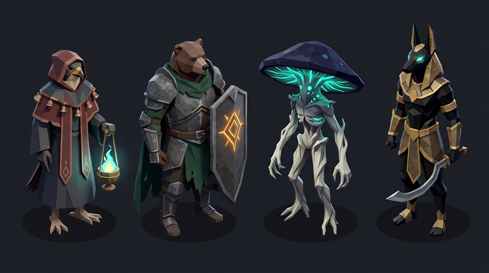
*Generated Concept 4 — **Faceted Low-Poly Character & Creature Lineup**: (Left to right) **Bellkeeper Falcon-folk Mystic** with tarnished shoulder-bells and cyan-flame censer; **Mossgate Ursine Warden** in battered iron plate with an amber-runed tower shield; **Hush-Touched Mycelid Stalker** with dark velvet cap, bioluminescent gill-veins, and pale root limbs; **Sun-Tomb Jackal Sentinel** in faceted black obsidian and funerary gold.*

#### Keeping Characters Fantastical, Readable & Pipeline-Safe
- **Wonder First, Uncanny Second:** Following [`docs/world.md`](./world.md) (*"odd creatures are strange and a little funny before they are frightening"*), creatures of the Hush should look **ancient, eerie, and enchanted** (bioluminescent gills, porcelain/bone masks, overgrown clockwork/roots, spectral eyes) rather than gory or visceral.
- **Chroma-Key Safety on `#FF00FF` (`key-cut.ts`):**
  - **Never use pure `#000000`** on dark armor or obsidian facets (keep darkest albedo facets at $L \ge 24$, e.g. `#181a24`, so normal-mapped rim light `RIM_LIGHT` separates limbs cleanly).
  - **Avoid saturated magenta/fuchsia (`#c000c0–#ff40ff`) on sprite silhouettes** so CIELAB key extraction against `#FF00FF` never eats into dark cloaks; shift arcane purples toward **deep indigo (`#2e2654`)** or **teal-cyan (`#4ef2e0`)**.
- **Drop-In `TWILIGHT_ISOMETRIC` Profile (`packages/server/src/assets/style-profile.ts`):**
  Because `co-MMO` centralizes all prompt style words in `STYLE_PROFILES` chosen via `ART_STYLE` in `.env`, a new `twilight-isometric` profile can be introduced **non-destructively** alongside `flat-isometric`:

```ts
const TWILIGHT_BASE = [
  'Stylised low-poly isometric dark-mythic fantasy game art, light-neutral.',
  'Flat faceted shapes built from clean geometric planes with crisp hard edges, like carved slate, tarnished metal and cut paper (Death\'s Door / Tunic aesthetic).',
  'NO BAKED DIRECTIONAL LIGHTING: every material uses flat base colours across its facets with no cast shadows, no gradients and no outer glow; facets meet at crisp thin dark seams.',
  'Rich twilight mineral palette: weathered charcoal-slate, smoked oak, tarnished bronze, oxblood crimson, bone ivory, deep pine-teal, accented sparingly by luminous cyan-teal wishstuff and warm amber.',
  'Avoid pure #000000 black and avoid magenta/fuchsia hues near #FF00FF. No writing anywhere.',
].join('\n');
```

---

### Proposal 5: Full-Bleed Material Kits, Emissive Relics & Diegetic UI

| Full-Bleed `128×128` Seamless Material Kit | Emissive Wishstuff Relics & Tarnished-Brass Framing |
| :---: | :---: |
| 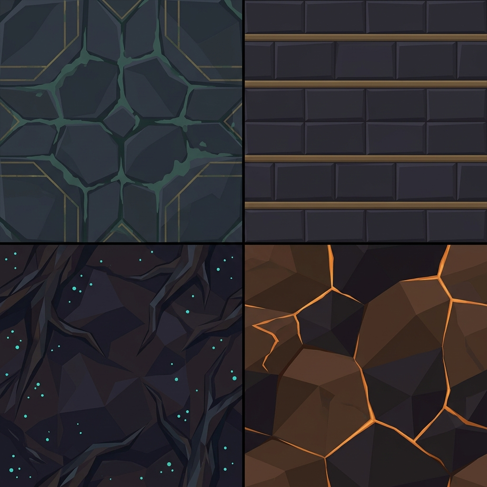 | 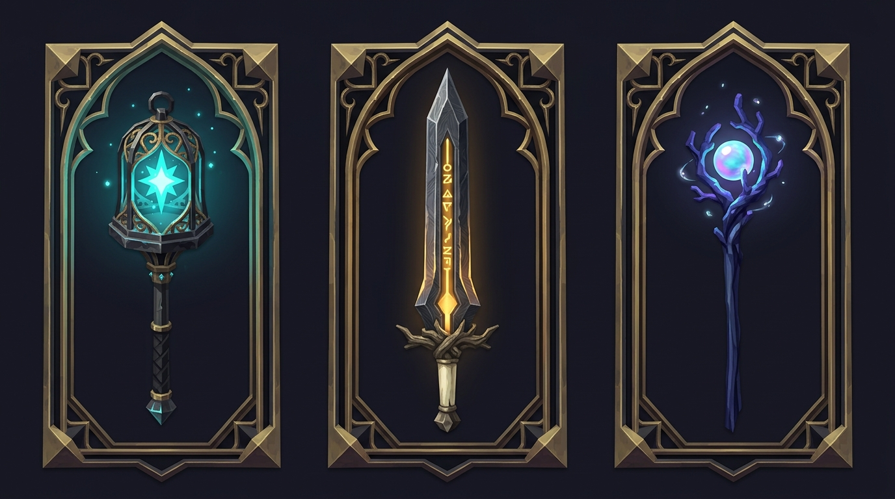 |
| *Generated Concept 5 — Square-on, unlit flat-faceted albedo tiles (`*-floor.png`, `*-wall.png`, ground): Obsidian & Moss Flagstones, Gothic Basalt & Bronze Ashlar, Twilight Root & Spore Soil, and Scorched Sun-Crypt Ember-Stone.* | *Generated Concept 6 — Held weapons (`held-*`) and item card frames: Bellkeeper's Star-Flame Censer, Mossgate Runic Greatsword, and Deep-Tide Pearl Staff framed in tarnished-brass gothic filigree.* |

#### Engine Shader, Lighting & UI Upgrades
1. **Activate Emissive Self-Illumination in `lit-pipeline.ts`:**
   Fulfill the planned hook at [`lit-pipeline.ts:75`](../packages/client/src/lit-pipeline.ts) by adding an optional `uEmissiveSampler` (or alpha/chroma emissive mask generated automatically for high-chroma cyan/amber magical cores) added *after* `color * vec4(light, 1.0)` so **runic fullers, lantern cores, potion flasks, mushroom gills, and stained glass shine undimmed at midnight**.
2. **Re-tune Sky & Directional Contrast (`lighting.ts` & `sky.ts`):**
   - Lower `SKY_FILL` from `0.55` to **`0.36`** and boost `KEYS` directional sun/moon strength by `+25%` so low-poly normal maps (`normal-maps.ts`) exhibit dramatic planar chiaroscuro.
   - Deepen `NIGHT_TINT` from `0x5866a8` (lavender) to **`0x26314a`** (deep nocturnal slate-indigo) and `WEATHER_TINT.storm` from `0x8f99ae` to **`0x58637a`**.
   - Tint `RIM_LIGHT` slightly cooler moonlight-silver (`[0.28, 0.34, 0.46]`) so characters stand out crisp and heroic against dark grounds.
   - Add a subtle radial **screen-space vignette** (`12–18%` edge darkening, scaling with `darkness(phase)` and indoor/cave depth) plus soft dark contact ellipses beneath trees and wall bases.
3. **Evolve the HUD from Tech-Monospace to Reliquary Brass (`packages/client/src/style.css`):**
   - Shift `--bg: #181425` / `--edge: #5a6988` / `ui-monospace` toward **obsidian-vellum panels (`rgba(16, 15, 22, 0.92)`)**, **tarnished-brass borders (`#8f7242`)** withchamfered or filigree corner ticks, warm parchment ink (`#efe8d8`), and a carved serif display font (e.g., *Cinzel* or *Cormorant SC*) for window titles, region banners, and Wish Cards while keeping crisp sans/mono legibility for combat numbers and chat.

---

## 5. Summary Roadmap: Incremental, Zero-Breakage Rollout

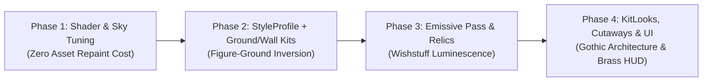

| Phase | Scope | Files Touched | Cost & Risk | Visual Impact |
| :--- | :--- | :--- | :--- | :--- |
| **Phase 1: Engine Chiaroscuro** | Tune `SKY_FILL` (`0.36`), `NIGHT_TINT` (`0x26314a`), weather tints, subtle vignette, and weather particles (rain streaks, drifting spores/embers). Gateable behind a mod or Sky preset. | `shared/src/lighting.ts`, `shared/src/sky.ts`, `client/src/lit-pipeline.ts` | **$0 API cost**, instant world-wide preview in God's View. | Immediate moodier nights, stronger normal-mapped facets, warmer lamp pools. |
| **Phase 2: Ground & Wall Value Shift** | Add `TWILIGHT_ISOMETRIC` in `style-profile.ts`; repaint launch biome ground/path/wall tiles to $L \in [45, 95]$ while keeping stairs $L \ge 110$. | `server/src/assets/style-profile.ts`, `shared/src/biomes.ts` | ~15–20 tile textures (can use free local pipeline + `--process-only`). | Fixes inverted figure-ground contrast; characters and spells pop off dark stone. |
| **Phase 3: Self-Lit Wishstuff (Emissive)** | Populate the `lit-pipeline.ts:75` glow map pass for shrines, lanterns, runes, windows, potions, and bioluminescent creatures. | `client/src/lit-pipeline.ts`, `client/src/textures.ts`, `shared/src/lighting.ts` | Zero breaking change (defaults to black/zero emissive when absent). | Magic, runes, eyes, and stained glass glow vividly in deep darkness. |
| **Phase 4: Gothic Kits & Reliquary UI** | Add dark-mythic `KitLook` entries (`basalt-sanctuary`, `smoked-timber`, `abyssal-coral`) and restyle HUD/Wish Cards in tarnished brass & obsidian. | `shared/src/building-kit/looks.ts`, `client/src/style.css` | ~6 kit sheets + CSS theme variables. | Complete cohesive **Twilight Mythic** identity from UI to architecture. |
