# Worked-out normal maps

What the game works out by itself for every picture shipped with it (`packages/client/src/relief.ts`), for looking at only: the game makes these as it loads, so nothing here is used.
Lavender blue faces you; pinker faces right, greener faces up the picture.

| Kind | Picture | As painted | Normal map |
|---|---|---|---|
| tile | bramble-cottage-door | 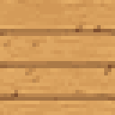 |  |
| building | bramble-cottage-exterior | 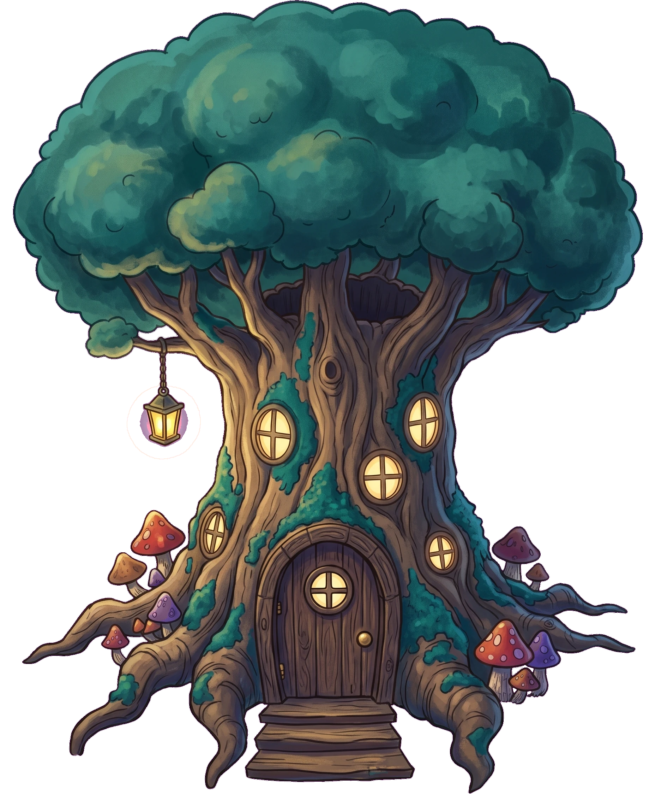 | 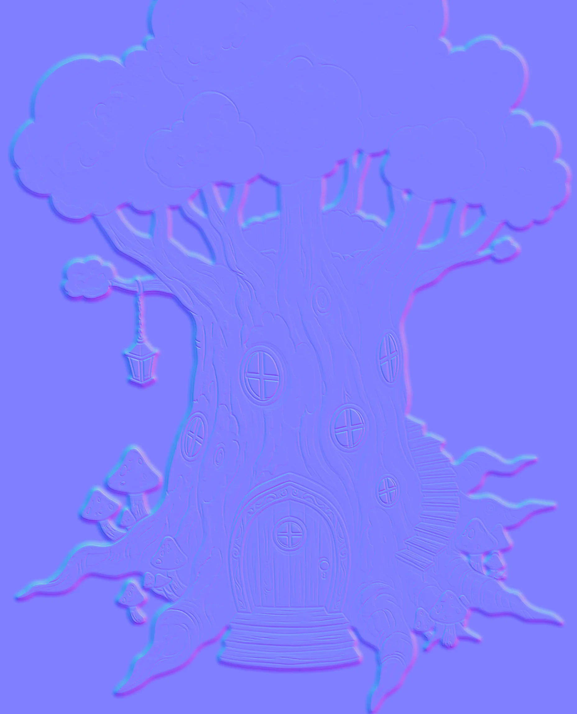 |
| tile | bramble-cottage-floor | 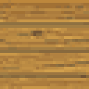 |  |
| furniture | bramble-cottage-furniture-barrel | 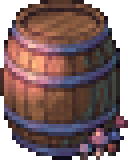 | 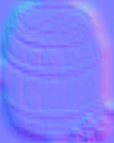 |
| furniture | bramble-cottage-furniture-bed | 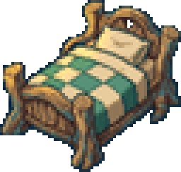 | 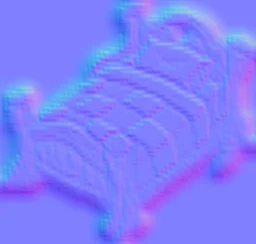 |
| furniture | bramble-cottage-furniture-bookshelf | 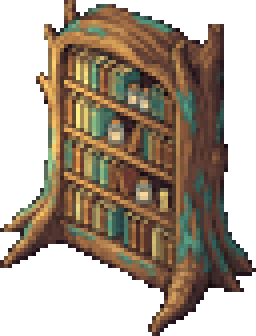 | 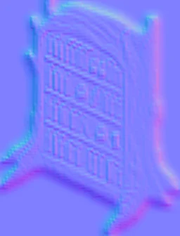 |
| furniture | bramble-cottage-furniture-cauldron | 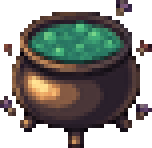 | 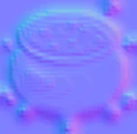 |
| furniture | bramble-cottage-furniture-hearth | 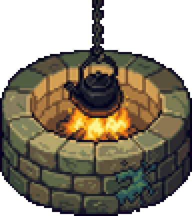 | 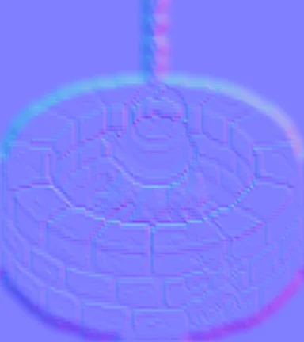 |
| furniture | bramble-cottage-furniture-herb-rack | 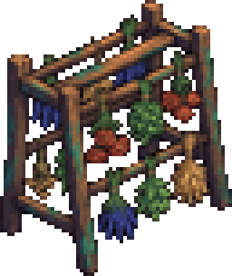 | 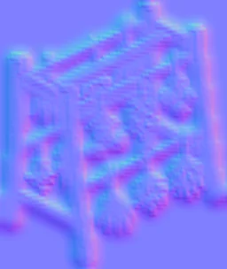 |
| furniture | bramble-cottage-furniture-table | 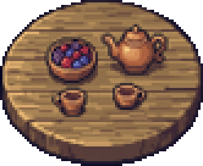 | 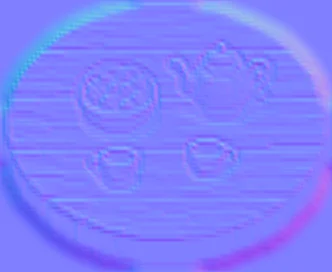 |
| tile | bramble-cottage-wall | 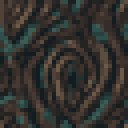 | 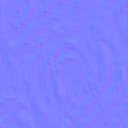 |
| tile | bridge-planks | 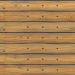 |  |
| prop | desert-cactus-a | 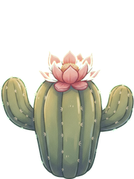 | 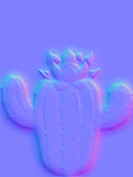 |
| prop | desert-cactus-b | 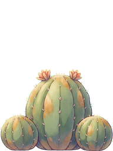 | 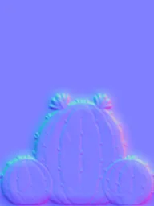 |
| npc | desert-cactus-folk |  | 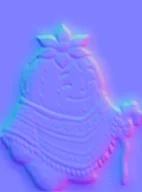 |
| monster | desert-dune-jackal | 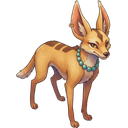 | 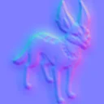 |
| tile | desert-dunes | 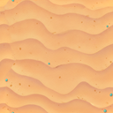 |  |
| monster | desert-mummy-guard | 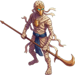 | 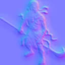 |
| tile | desert-oasis | 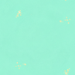 |  |
| set-piece | desert-obelisk | 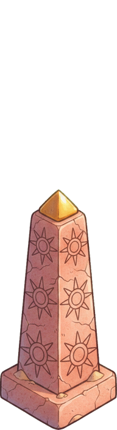 |  |
| tile | desert-palace-door | 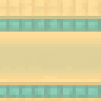 |  |
| building | desert-palace-exterior | 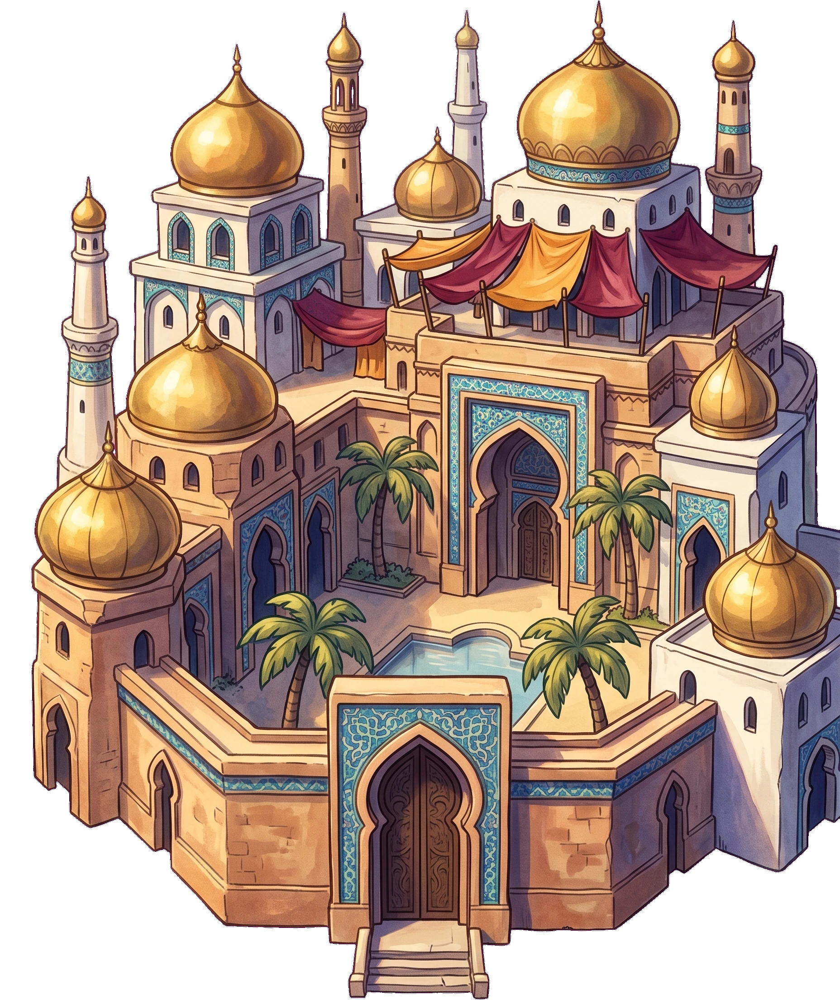 | 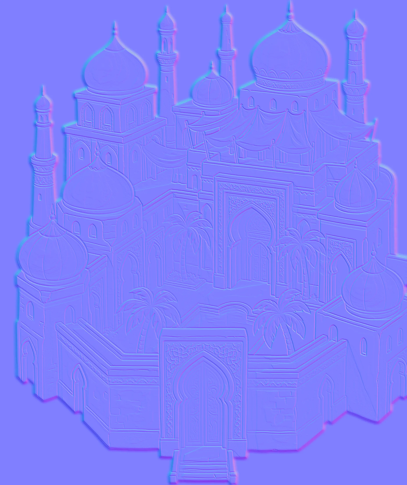 |
| tile | desert-palace-floor | 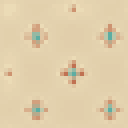 | 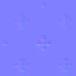 |
| furniture | desert-palace-furniture-carpet | 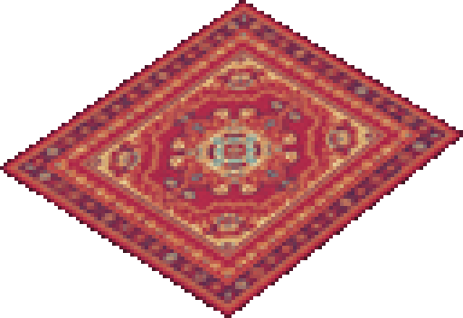 | 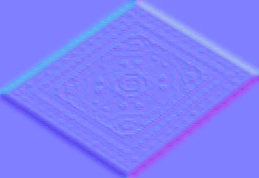 |
| furniture | desert-palace-furniture-cushions | 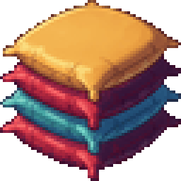 | 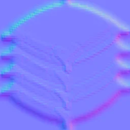 |
| furniture | desert-palace-furniture-golden-throne | 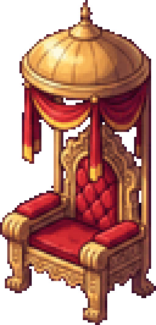 | 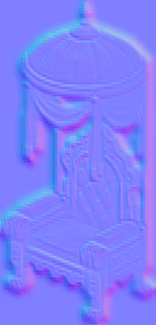 |
| furniture | desert-palace-furniture-palace-fountain | 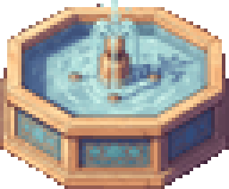 | 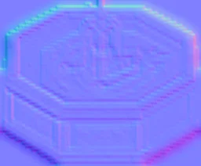 |
| furniture | desert-palace-furniture-palm-pot | 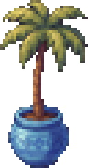 |  |
| tile | desert-palace-wall | 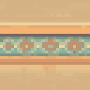 |  |
| set-piece | desert-pyramid | 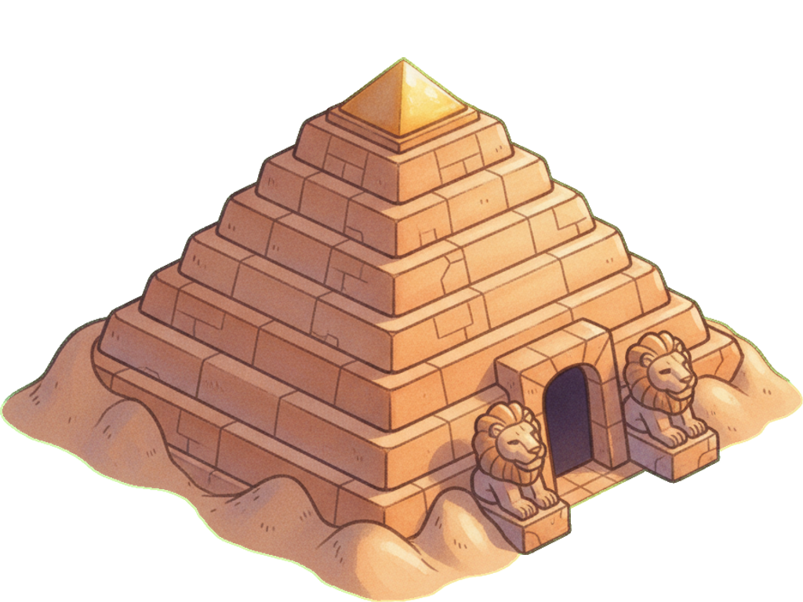 | 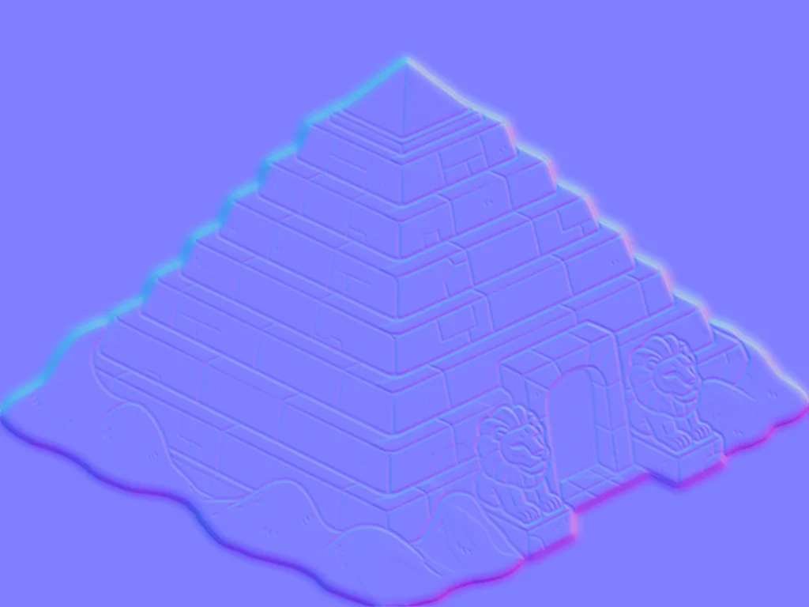 |
| prop | desert-rock |  |  |
| set-piece | desert-ruin |  |  |
| monster | desert-sand-wyrm |  |  |
| monster | desert-scarab |  |  |
| npc | desert-sultana |  |  |
| tile | desert-tomb-door |  |  |
| building | desert-tomb-exterior |  |  |
| tile | desert-tomb-floor |  |  |
| furniture | desert-tomb-furniture-canopic-jars |  |  |
| furniture | desert-tomb-furniture-sarcophagus |  |  |
| furniture | desert-tomb-furniture-sun-statue |  |  |
| tile | desert-tomb-wall |  |  |
| set-piece | desert-wyrm-bones |  |  |
| effect | fx-slash |  |  |
| item | item-ancient-linen |  |  |
| item | item-bible |  |  |
| item | item-coral-spear |  |  |
| item | item-crab-lance |  |  |
| item | item-crab-shell |  |  |
| item | item-firebolt |  |  |
| item | item-goat-horn |  |  |
| item | item-golem-club |  |  |
| item | item-gull-feather |  |  |
| item | item-heartwood |  |  |
| item | item-jackal-fang |  |  |
| item | item-moth-dust |  |  |
| item | item-mushroom-cap |  |  |
| item | item-mushroom-hat |  |  |
| item | item-pearl |  |  |
| item | item-pelt-cloak |  |  |
| item | item-scarab-charm |  |  |
| item | item-scarab-shell |  |  |
| item | item-scroll |  |  |
| item | item-shell-mail |  |  |
| item | item-sunstone-amulet |  |  |
| item | item-temple-lantern |  |  |
| item | item-tonic |  |  |
| item | item-traveller-coat |  |  |
| item | item-wolf-pelt |  |  |
| item | item-wooden-sword |  |  |
| item | item-wyrm-scale |  |  |
| player | player-ilya |  |  |
| player | player-mara |  |  |
| npc | sanctum-bell-keeper |  |  |
| set-piece | sanctum-bell-tower |  |  |
| prop | sanctum-blossom-tree-a |  |  |
| prop | sanctum-blossom-tree-b |  |  |
| tile | sanctum-flagstones |  |  |
| set-piece | sanctum-fountain |  |  |
| monster | sanctum-lantern-moth |  |  |
| tile | sanctum-meadow |  |  |
| npc | sanctum-pilgrim |  |  |
| tile | sanctum-pond |  |  |
| prop | sanctum-rock |  |  |
| set-piece | sanctum-shrine |  |  |
| set-piece | sanctum-standing-stones |  |  |
| tile | sanctum-temple-door |  |  |
| building | sanctum-temple-exterior |  |  |
| tile | sanctum-temple-floor |  |  |
| furniture | sanctum-temple-furniture-altar |  |  |
| furniture | sanctum-temple-furniture-bell-rack |  |  |
| furniture | sanctum-temple-furniture-brazier |  |  |
| furniture | sanctum-temple-furniture-pew |  |  |
| tile | sanctum-temple-wall |  |  |
| tile | shore-coral-palace-door |  |  |
| building | shore-coral-palace-exterior |  |  |
| tile | shore-coral-palace-floor |  |  |
| furniture | shore-coral-palace-furniture-coral-throne |  |  |
| furniture | shore-coral-palace-furniture-giant-clam |  |  |
| furniture | shore-coral-palace-furniture-kelp-pillar |  |  |
| furniture | shore-coral-palace-furniture-pearl-fountain |  |  |
| tile | shore-coral-palace-wall |  |  |
| monster | shore-crab-knight |  |  |
| monster | shore-drowned-deckhand |  |  |
| set-piece | shore-giant-shell |  |  |
| monster | shore-gull-raider |  |  |
| monster | shore-hermit-crab |  |  |
| set-piece | shore-lighthouse |  |  |
| prop | shore-palm-a |  |  |
| prop | shore-palm-b |  |  |
| prop | shore-rock |  |  |
| tile | shore-sand |  |  |
| tile | shore-sea |  |  |
| tile | shore-sea-cave-door |  |  |
| building | shore-sea-cave-exterior |  |  |
| tile | shore-sea-cave-floor |  |  |
| furniture | shore-sea-cave-furniture-rope-coil |  |  |
| furniture | shore-sea-cave-furniture-rum-barrel |  |  |
| furniture | shore-sea-cave-furniture-ship-lantern |  |  |
| furniture | shore-sea-cave-furniture-treasure-chest |  |  |
| tile | shore-sea-cave-wall |  |  |
| npc | shore-sea-queen |  |  |
| set-piece | shore-shipwreck |  |  |
| set-piece | shore-tide-shrine |  |  |
| npc | shore-trader |  |  |
| monster | woods-bark-golem |  |  |
| tile | woods-castle-door |  |  |
| building | woods-castle-exterior |  |  |
| tile | woods-castle-floor |  |  |
| furniture | woods-castle-furniture-armour-stand |  |  |
| furniture | woods-castle-furniture-pillar |  |  |
| furniture | woods-castle-furniture-tapestry |  |  |
| furniture | woods-castle-furniture-throne |  |  |
| set-piece | woods-castle-gate |  |  |
| tile | woods-castle-wall |  |  |
| tile | woods-cave-door |  |  |
| building | woods-cave-exterior |  |  |
| tile | woods-cave-floor |  |  |
| furniture | woods-cave-furniture-crystals |  |  |
| furniture | woods-cave-furniture-old-chest |  |  |
| furniture | woods-cave-furniture-stalagmite |  |  |
| tile | woods-cave-wall |  |  |
| set-piece | woods-fairy-ring |  |  |
| set-piece | woods-fallen-giant |  |  |
| npc | woods-herbalist |  |  |
| tile | woods-moss |  |  |
| monster | woods-mushroom |  |  |
| npc | woods-old-knight |  |  |
| tile | woods-path |  |  |
| tile | woods-pool |  |  |
| prop | woods-rock |  |  |
| monster | woods-thorn-wolf |  |  |
| prop | woods-tree-a |  |  |
| prop | woods-tree-b |  |  |
| set-piece | woods-tree-house |  |  |
